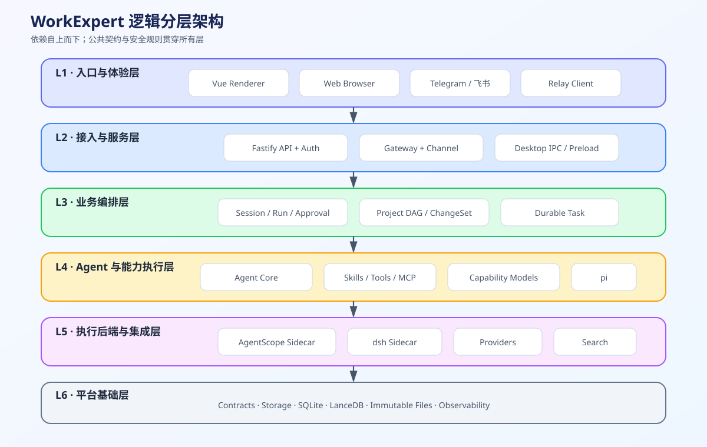
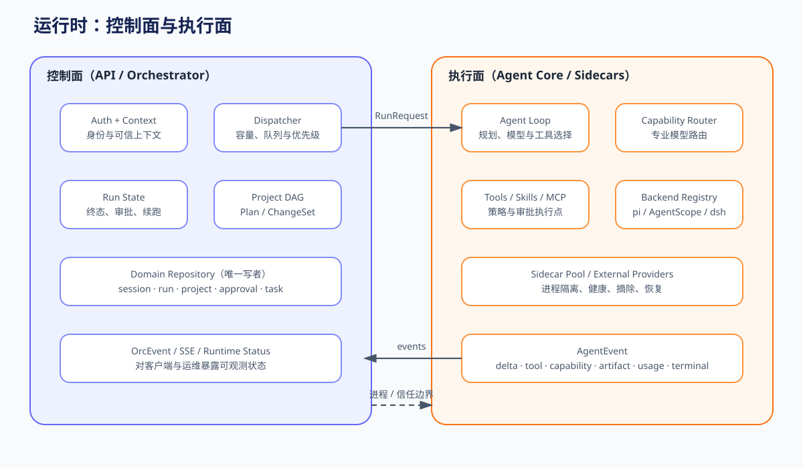
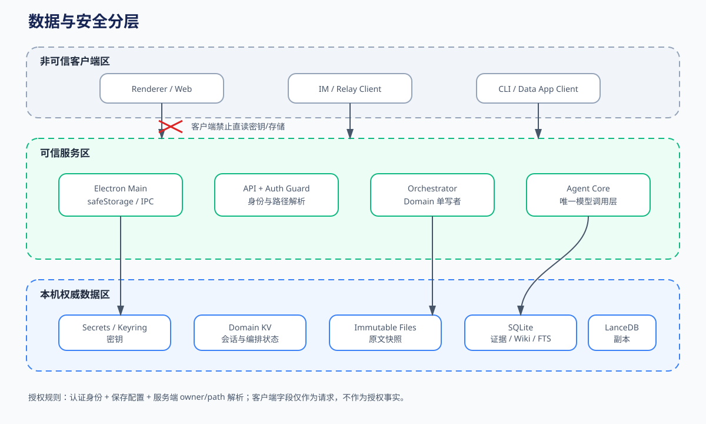
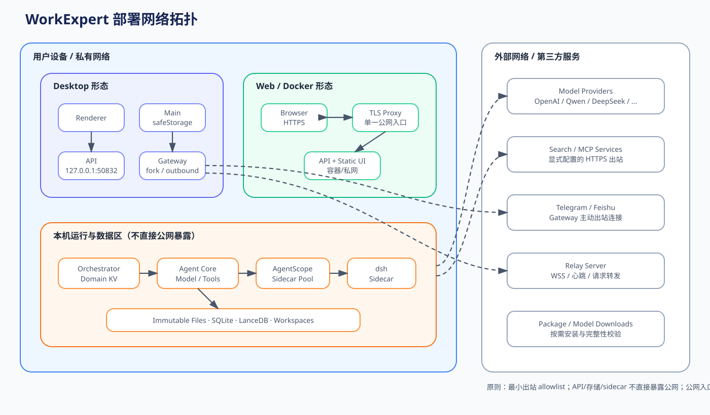

# ADR 可视化附录：WorkExpert 分层架构与部署拓扑图

> 状态：待评审  
> 规格版本：1.0.0  
> 更新日期：2026-10-27  
> 归档位置：ADR 决策体系可视化附录（本页不单独产生新决策）  
> 关联：[ADR 索引](README.md) · [PAB-001 平台架构基线](../../sdd/features/platform-architecture/README.md) · [全局架构](../architecture.md) · [部署说明](../../deploy/README.md)

本页是架构规格的图形视图。图中实线表示允许的主要调用或数据流，虚线表示进程/信任边界或可选连接；准确行为与状态仍以 PAB-001 和功能 SDD 为准。

## 1. 逻辑分层架构

关键规则：

- 入口层不能绕过服务层直接访问模型、域存储或密钥。
- Orchestrator 管理会话、run、审批、项目和持续任务；Agent Core 是唯一模型调用层。
- Contracts 是跨包公共结构的事实源；Storage 管理权威数据与可重建索引的边界。

## 2. 运行时控制面与执行面

控制面负责身份、配置、调度、审批和状态；执行面负责模型循环、工具和 sidecar。`AgentEvent`/`OrcEvent` 连接两侧，但 sidecar、Gateway 和 Renderer 都不是域状态写者。

## 3. 数据与安全分层

安全不变量：密钥只在可信主进程或部署秘密源中解密；domain KV 由 API 单写；知识原文和权威证据不能被向量索引替代；客户端提交的 owner、org、路径和权限不能覆盖服务端裁决。

## 4. 部署网络拓扑

部署说明：

- Desktop 默认将 UI 与 API 绑定在 loopback；API 默认端口为 `127.0.0.1:50832`，开发 UI 默认端口为 `127.0.0.1:50831`。
- Web/Docker 形态应由 TLS 反向代理暴露单一入口，API 不应直接暴露到公网。
- Gateway 对 Telegram、飞书和 Relay 使用出站连接；外部通道不得直接访问本机存储或 sidecar。
- 云模型、搜索和 MCP 是按配置启用的出站依赖；防火墙应采用最小出站 allowlist。

## 5. 图形维护规则

SVG 源文件位于 `docs/architecture/adr/diagrams/`。若端口、进程、信任区或依赖方向改变，必须同步更新 PAB-001；若改变长期边界，还需新增 ADR，不能只改图。
